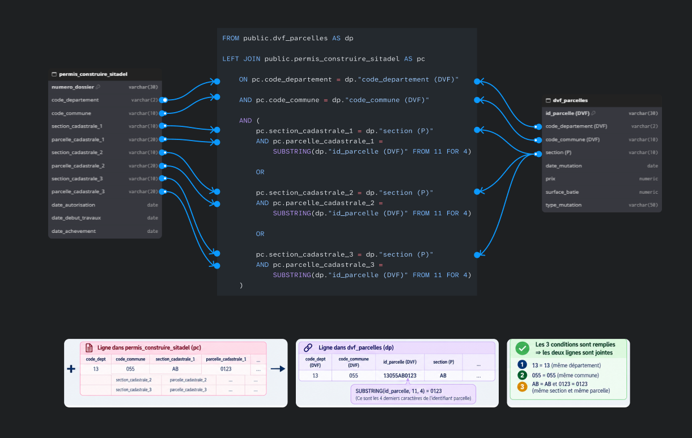
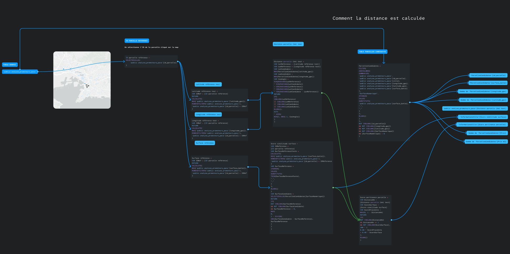
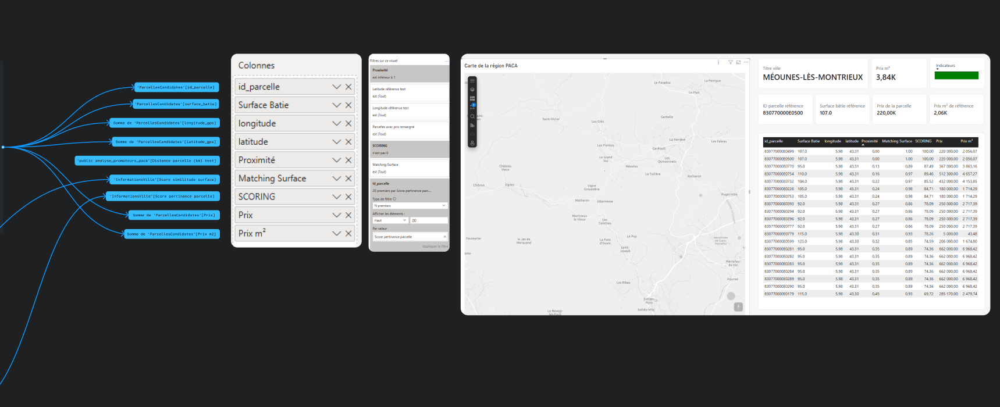
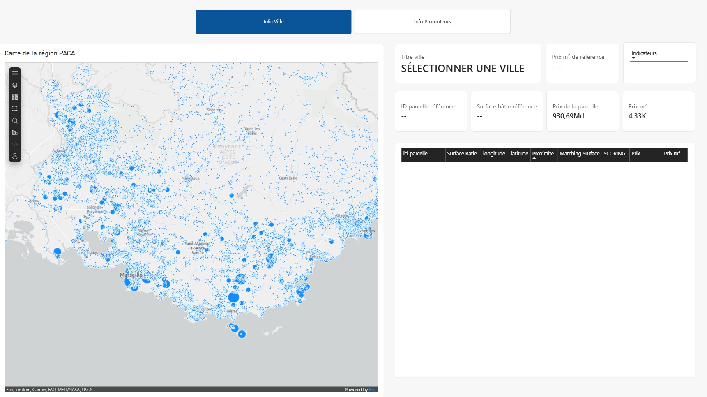
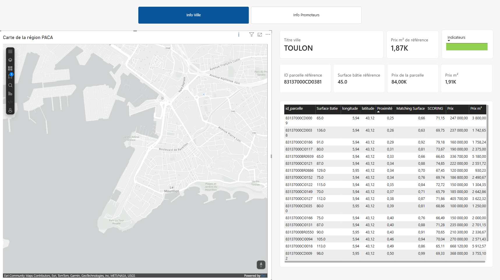
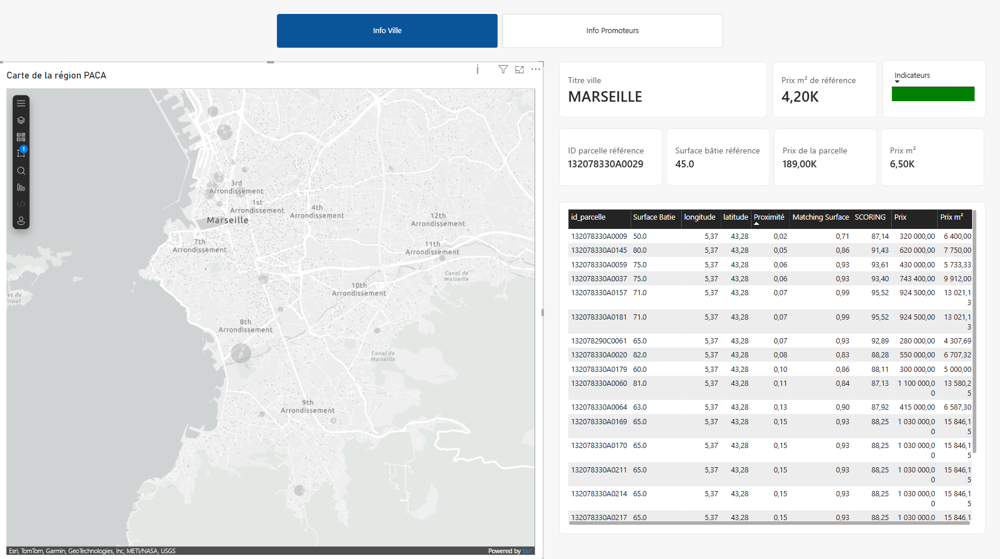
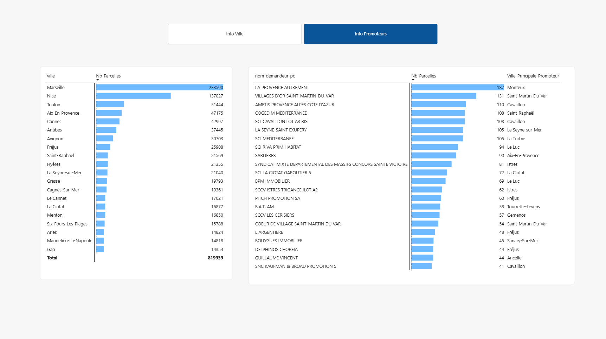

# 🏗️ Analyse des promoteurs immobiliers en région PACA

## 📌 Présentation du projet

Ce projet consiste à développer un outil d'analyse du marché immobilier en région Provence-Alpes-Côte d'Azur (PACA), permettant de croiser plusieurs sources de données publiques afin d'explorer les transactions immobilières, les parcelles cadastrales, les permis de construire et l'activité des promoteurs immobiliers.

L'objectif est de construire une base de données enrichie à partir de différentes sources, puis de développer un tableau de bord interactif sous Power BI pour analyser le marché immobilier à l'échelle régionale et locale.

Le projet intègre également un système de recherche de parcelles comparables, reposant sur la proximité géographique et la similarité des surfaces bâties.

## 🎯 Objectifs

* Explorer et préparer plusieurs sources de données immobilières publiques.
* Transformer et structurer les données avec Python et DuckDB.
* Stocker les données dans PostgreSQL et PostGIS.
* Rapprocher les transactions immobilières des références cadastrales.
* Associer les permis de construire aux parcelles concernées.
* Enrichir les informations relatives aux demandeurs avec les données SIRENE.
* Analyser l'activité immobilière des promoteurs en région PACA.
* Développer une cartographie interactive sous Power BI.
* Identifier des parcelles comparables grâce à un système de scoring multicritère.

## 🗂️ Sources de données

Le projet repose sur cinq sources principales :

| Source   | Utilisation                                        |
| -------- | -------------------------------------------------- |
| DVF      | Transactions et prix immobiliers                   |
| DVF+     | Transactions enrichies et références cadastrales   |
| Cadastre | Informations et géométries des parcelles           |
| SIRENE   | Informations sur les entreprises et établissements |
| SITADEL  | Permis de construire et opérations immobilières    |

### Périmètre géographique

L'analyse couvre les six départements de la région Provence-Alpes-Côte d'Azur :

| Département             | Code |
| ----------------------- | ---- |
| Alpes-de-Haute-Provence | 04   |
| Hautes-Alpes            | 05   |
| Alpes-Maritimes         | 06   |
| Bouches-du-Rhône        | 13   |
| Var                     | 83   |
| Vaucluse                | 84   |

## 🛠️ Technologies utilisées

| Technologie       | Utilisation                                          |
| ----------------- | ---------------------------------------------------- |
| Python            | Exploration, préparation et import des données       |
| Pandas            | Manipulation des données                             |
| DuckDB            | Exploration et transformation de fichiers volumineux |
| PyArrow / Parquet | Stockage et traitement des données                   |
| PostgreSQL        | Stockage relationnel                                 |
| PostGIS           | Gestion des données géographiques                    |
| SQL               | Création de tables, jointures et contrôles           |
| Power BI          | Visualisation et analyse interactive                 |
| DAX               | Indicateurs et scoring multicritère                  |

## ⚙️ Méthodologie

### 1. Exploration et préparation des données

Les différentes sources sont explorées à l'aide de Python et DuckDB.

Les traitements comprennent :

* L'analyse des structures et des colonnes.
* Le filtrage géographique sur les six départements PACA.
* La sélection des données nécessaires à l'analyse.
* La conversion de fichiers sources au format Parquet.
* Le contrôle des volumes et de la répartition géographique.

### 2. Importation dans PostgreSQL / PostGIS

Les données préparées sont importées dans PostgreSQL.

Des scripts Python permettent notamment :

* L'import des établissements et unités légales SIRENE.
* L'import des permis de construire SITADEL.
* L'import des transactions DVF+ par lots.
* L'import des parcelles cadastrales et de leurs géométries.
* L'import des communes de la région PACA.

Des contrôles sont réalisés pour vérifier les volumes importés, les départements présents, les géométries et la cohérence des données.

### 3. Rapprochement des transactions et des parcelles cadastrales

Une table intermédiaire `dvf_parcelles` est construite à partir des transactions DVF et des références cadastrales.

Les références cadastrales contenues dans les transactions sont décomposées afin de rapprocher chaque transaction des informations cadastrales correspondantes.

Les données récupérées comprennent notamment :

* L'identifiant de mutation.
* La date de transaction.
* Le prix de vente.
* La surface bâtie.
* Les coordonnées géographiques.
* L'identifiant de parcelle.
* La section cadastrale.
* La contenance cadastrale.

### 4. Rapprochement avec les permis de construire SITADEL

Les transactions et les parcelles cadastrales sont ensuite rapprochées des permis de construire.

La correspondance repose sur :

* Le code département.
* Le code commune.
* La section cadastrale.
* Le numéro de parcelle.

Les trois références cadastrales possibles d'un permis de construire sont prises en compte.

Les données SIRENE permettent ensuite d'enrichir les informations relatives aux demandeurs avec les caractéristiques de leurs établissements.

Le résultat est stocké dans la table :

`analyse_promoteurs_paca`

Cette table constitue la base principale du tableau de bord Power BI.

### Schéma du rapprochement cadastral



### Workflow de traitement et de rapprochement





## 📍 Recherche de parcelles comparables

Une fonctionnalité spécifique permet de rechercher des parcelles comparables à partir d'une parcelle de référence sélectionnée sur la carte.

Le système évalue les parcelles candidates selon deux critères :

| Critère                        | Pondération |
| ------------------------------ | ----------: |
| Proximité géographique         |        60 % |
| Similarité de la surface bâtie |        40 % |
| **Total**                      |   **100 %** |

La distance géographique est calculée entre la parcelle de référence et les parcelles candidates.

Le périmètre de recherche est limité à 1 km.

### Calcul du score de pertinence avec DAX

```dax
Score pertinence parcelle =
VAR DistanceKm =
    [Distance parcelle (km) test]

VAR ScoreSurface =
    [Score similitude surface]

VAR ScoreProximite =
    MAX(0, 1 - DistanceKm)

RETURN
IF(
    NOT ISBLANK(DistanceKm)
        && DistanceKm <= 1
        && NOT ISBLANK(ScoreSurface),

    100 * (
        0.60 * ScoreProximite
        + 0.40 * ScoreSurface
    ),

    BLANK()
)
```

Le score final est compris entre 0 et 100.

Les parcelles situées à plus d'un kilomètre sont exclues du classement.

Cette approche permet de classer les parcelles candidates en tenant compte simultanément de leur proximité géographique et de la similarité de leurs surfaces bâties.

## 📊 Tableau de bord Power BI

Le rapport Power BI propose deux espaces d'analyse complémentaires.

### 1. Info Ville

Cette page permet :

* De visualiser les parcelles sur une carte interactive de la région PACA.
* De sélectionner une ville.
* De consulter les informations d'une parcelle de référence.
* D'analyser les prix immobiliers au m².
* D'identifier les parcelles comparables.
* De consulter leur distance, leur surface et leur score de pertinence.

#### Vue générale de la région PACA



#### Analyse immobilière de Toulon



#### Analyse immobilière de Marseille



### 2. Info Promoteurs

Cette page permet :

* De visualiser le nombre de parcelles par ville.
* De classer les promoteurs selon leur nombre de parcelles.
* D'identifier les principales villes d'activité des promoteurs.
* D'explorer la répartition géographique de leur activité.



## 📁 Structure du projet

```text
projet-data-promoteurs-paca/
│
├── data/
│   ├── raw/
│   ├── processed/
│   └── exports/
│
├── images/
│   ├── 00_maps.png
│   ├── 01_info_ville.png
│   ├── 02_info_ville_marseille.png
│   ├── 03_info_promoteurs.png
│   ├── jointure_parcelles.png
│   ├── workflow_01.png
│   └── workflow_02.png
│
├── script/
│   ├── 01_exploration_sirene.py
│   ├── 02_exploration_siret.py
│   ├── 03_exploration_transactions_dvf.py
│   ├── 04_exploration_transactions_dvf_plus.py
│   ├── 05_exploration_cadastre.py
│   ├── 06_exploration_sitadel.py
│   ├── conversion_dvf_plus_parquet.py
│   ├── db_config.py
│   ├── importer_communes.py
│   ├── importer_parcelles_postgres.py
│   ├── importer_sirene.py
│   ├── importer_sitadel_postgres.py
│   ├── importer_transactions_dvf_postgres.py
│   ├── inspecter_parcelles.py
│   ├── verifier_communes.py
│   └── verifier_geometries.py
│
├── sql/
│   ├── 02_create_table_dvf_parcelles.sql
│   ├── 03_jointure_dvf_cadastre.sql
│   └── 04_create_table_analyse_promoteurs_paca.sql
│
├── .env.example
├── .gitignore
├── README.md
└── requirements.txt
```

Les données sources, les fichiers Parquet intermédiaires, les identifiants de connexion et les fichiers volumineux Power BI ne sont pas inclus dans le dépôt GitHub.

## 🚀 Installation et configuration

### 1. Cloner le dépôt

```bash
git clone URL_DU_DEPOT
cd projet-data-promoteurs-paca
```

### 2. Créer un environnement virtuel

```bash
python -m venv .venv
```

Activation sous Windows :

```powershell
.\.venv\Scripts\Activate.ps1
```

### 3. Installer les dépendances

```bash
pip install -r requirements.txt
```

### 4. Configurer PostgreSQL

Créer une base de données PostgreSQL avec l'extension PostGIS.

Copier le fichier `.env.example` vers `.env`, puis renseigner les paramètres de connexion locaux.

Le fichier `.env` contenant les identifiants ne doit jamais être publié sur GitHub.

### 5. Préparer les données

Placer les fichiers sources dans les dossiers correspondants de `data/raw/`, puis exécuter les scripts de préparation et d'importation selon les dépendances entre les tables.

Les requêtes SQL permettent ensuite de construire les tables nécessaires à l'analyse.

## 🎓 Compétences développées

* Exploration et préparation de données volumineuses.
* Manipulation de fichiers CSV, TXT, Parquet et GeoJSON.
* Analyse et transformation avec Python, Pandas et DuckDB.
* Modélisation relationnelle avec PostgreSQL.
* Manipulation de données spatiales avec PostGIS.
* Jointures SQL complexes sur des références cadastrales.
* Intégration de plusieurs sources de données publiques.
* Création de mesures et de calculs métier avec DAX.
* Visualisation géographique avec Power BI.
* Développement d'un système de scoring multicritère.
* Analyse territoriale et immobilière.

---

**Projet personnel de Data Analytics — Analyse immobilière en région Provence-Alpes-Côte d'Azur.**